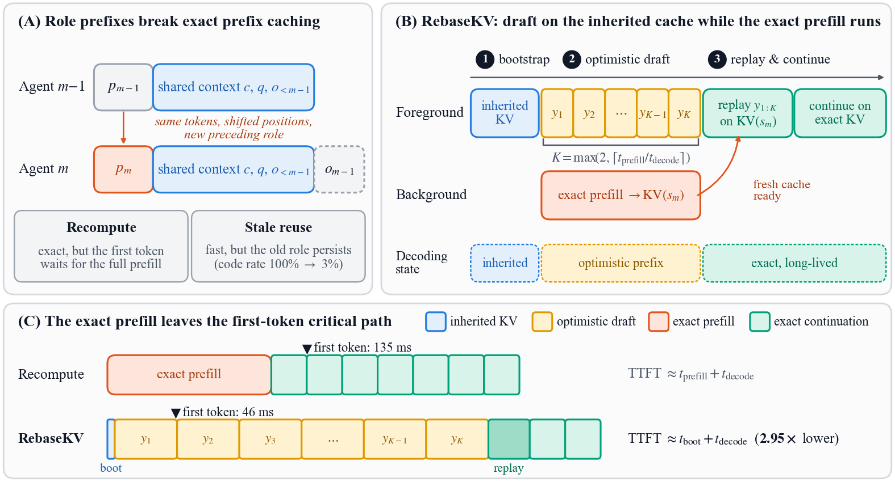

# RebaseKV

Code and per-question outputs for **RebaseKV: Hiding Prefill Latency in Multi-Agent LLMs via Optimistic Cache Alignment**.

At an agent handoff, RebaseKV decodes a short optimistic draft from the position-adjusted cache inherited from the previous agent while the exact prefill of the new prompt runs concurrently on the same GPU. When the fresh cache is ready, the draft is replayed on it and decoding continues on the exact cache. In a five-agent GSM8K pipeline the first token of each handoff arrives 2.95x earlier than with full recomputation (46 vs. 135 ms on an RTX A6000).



## Layout

```
scripts/     experiment drivers (run from the repository root; they import scripts.spec_rebase_bench)
analysis/    scripts that recompute every table number from results/
results/     per-question outputs behind the tables (JSONL, one line per question)
data/        KVCOMM GSM8K role prompts, HumanEval (MultiPL-E Python), offline Wikipedia cache for MMLU
figures/     scripts that draw the paper figures
```

## Setup

```bash
python -m venv .venv && source .venv/bin/activate
pip install -r requirements.txt          # transformers 5.14
export PYTHONPATH=$PWD
```

Models are standard Hugging Face checkpoints: `Qwen/Qwen2.5-7B-Instruct` (GSM8K, MMLU), `Qwen/Qwen2.5-Coder-7B-Instruct` (HumanEval) and `Qwen/Qwen3-8B` (set `REBASEKV_MODEL=Qwen/Qwen3-8B`). GSM8K is loaded from the Hugging Face hub. For MMLU, place the validation CSVs of the original release (`data.tar` from Hendrycks et al.) under `data/MMLU/data/val/`.

New runs write to `runs/` (ignored by git); every driver resumes from the questions already written. Override the output directory with the environment variable named in each script's header.

## Reproducing the tables

All analysis commands run on CPU from the released results.

| Paper | Run | Results | Analysis |
|---|---|---|---|
| Table 1, GSM8K | `python scripts/_gsm8k_full_methods.py {recompute,stale,hybrid} <shard> <n_shards>` | `results/gsm8k_full/` | `python analysis/rebuttal_stats.py .` |
| Table 1, MMLU | `python scripts/spec_rebase_mmlu_faithful.py --method {recompute,stale,hybrid} --n 153 --samples 4` | | |
| Table 1, HumanEval | `python scripts/spec_rebase_humaneval_faithful.py --method {recompute,stale,hybrid} --samples 4` | | |
| Table 2, A100 rows | as Table 1, GSM8K | `results/gsm8k_full/` | `python analysis/rebuttal_stats.py .` |
| Table 2, Decision Maker exact (A6000) | `GSM8K_N=300 EXACT_AGENTS=4 python scripts/_gsm8k_hybrid_exact_agents.py <shard> <n_shards>`; `GSM8K_N=300 python scripts/_gsm8k_full_methods.py recompute 0 1` | `results/a6000/gsm8k_dm_exact/` | `python analysis/paired.py results/a6000/gsm8k_dm_exact/recompute results/a6000/gsm8k_dm_exact/hybrid_exact4` |
| Table 2, Qwen3-8B | same drivers with `REBASEKV_MODEL=Qwen/Qwen3-8B` | `results/a6000/gsm8k_qwen3/` | `python analysis/paired.py results/a6000/gsm8k_qwen3/{recompute,hybrid,hybrid_exact4}` |
| Table 3, two-stream execution | `scripts/_rebasekv_real_twostream.py`, see below | `results/a6000/twostream/` | `python analysis/twostream_report.py results/a6000/twostream A_fixed_all_naive B_fixed_all_prio C_event_all_prio D_fixed_exact4_prio` (Qwen2.5) and `... Q3_twostream_prio` (Qwen3) |
| Table 4, RelayCaching | RelayCaching's own harness (see paper, Appendix C) | `results/a6000/relaycaching/` | `python analysis/relaycaching_report.py results/a6000/relaycaching gsm8k_full_greedy gsm8k_relay_greedy` |
| Table 4, our rows; Table 7 | Table 3 runs | `results/a6000/twostream/` | `python analysis/twostream_report.py results/a6000/twostream D_fixed_exact4_prio B_fixed_all_prio` (per-agent tables) |
| Table 5, window size | `python scripts/_gsm8k_k_ablation.py <K> <shard> <n_shards>` with `GSM8K_N=300` | `results/gsm8k_kablation/` | `python analysis/rebuttal_stats.py .` |
| Table 6, stale-trajectory KL | `python scripts/_kl_cum_multiq.py --nq 12 --S 4` | `results/kl/` | |
| Table 8 (a), WarmupKV | `NQ=1319 python scripts/_warmupkv_run.py gsm8k 0 1` | `results/warmupkv/` | `python analysis/rebuttal_stats.py .` |
| Table 8 (b), pipeline depth | `python scripts/_rebase_agent_sweep_he.py <N>` for N = 2..5 | `results/humaneval_agent_sweep/` | summary JSON per run |

### Two-stream configurations (Table 3)

```bash
TS=scripts/_rebasekv_real_twostream.py
COMMON="NQ=200 PREFILL_CHUNK=0"
env $COMMON REBASE_POLICY=fixed EXACT_AGENTS=  FG_PRIORITY=1 BG_THREAD=1 OUTDIR=runs/B_fixed_all_prio    python $TS 0 1  # serving-style
env $COMMON REBASE_POLICY=event EXACT_AGENTS=  FG_PRIORITY=1 BG_THREAD=1 OUTDIR=runs/C_event_all_prio    python $TS 0 1  # event-driven window
env $COMMON REBASE_POLICY=fixed EXACT_AGENTS=4 FG_PRIORITY=1 BG_THREAD=1 OUTDIR=runs/D_fixed_exact4_prio python $TS 0 1  # Decision Maker exact
env $COMMON REBASE_POLICY=fixed EXACT_AGENTS=  FG_PRIORITY=0 BG_THREAD=0 OUTDIR=runs/A_fixed_all_naive   python $TS 0 1  # no stream priority
env NQ=100 REBASEKV_MODEL=Qwen/Qwen3-8B REBASE_POLICY=fixed EXACT_AGENTS= FG_PRIORITY=1 BG_THREAD=1 \
    OUTDIR=runs/Q3_twostream_prio python $TS 0 1
```

The foreground draft runs on a high-priority CUDA stream and the exact prefill is issued from a background thread on a second stream; `FG_PRIORITY` and `BG_THREAD` switch these off.

## Options

| Variable | Default | Effect |
|---|---|---|
| `REBASEKV_MODEL` | `Qwen/Qwen2.5-7B-Instruct` | model for the GSM8K/MMLU drivers |
| `EXACT_AGENTS` | empty | comma-separated agent indices that take the exact path (4 = Decision Maker) |
| `REBASEKV_EXACT_REPLAY` | `0` | `1` feeds every token exactly once: the inherited cache stops before the last prompt token, which opens the draft, and decoding after the replay continues from the replay's last logits. With identical inherited and exact caches this reproduces recomputation token for token. `0` reproduces the released results. |

## Acknowledgments

The GSM8K, MMLU and HumanEval role prompts follow [KVCOMM](https://github.com/FastMAS/KVCOMM); HumanEval uses the [MultiPL-E](https://github.com/nuprl/MultiPL-E) Python translation.

## License

Apache-2.0. See [LICENSE](LICENSE).
